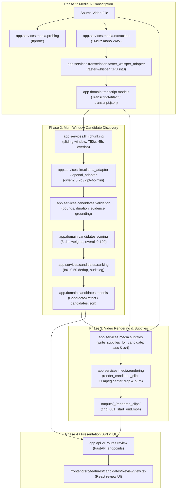

# AI Video Clipper — Architecture Review & Implementation Plan

**Document Status**: Repository-Grounded Architecture Review & Staged Implementation Plan  
**Target Architecture**: `docs/AI_Video_Clipper_End_to_End_Architecture_Plan_v0.1.md`  
**Approved Specifications**: `AI_Video_Clipper_PRD_v0.2.1.docx` & `AI_Video_Clipper_TechSpec_v0.2.1.docx`  
**Date**: 2026-10-24  
**Author**: Antigravity Assistant (Pair Programming Review)

---

## 1. Executive Summary & Review Scope

This review evaluates the proposed **AI Video Clipper End-to-End Product & Architecture Plan v0.1** against the live codebase at `C:\Lakshya\Coding\EquinoLabs\ai-video-clipper` and the approved PRD / TechSpec v0.2.1.

### Primary Architecture Evolution
The architecture plan introduces two critical, high-leverage paradigms that directly address the core editorial defects identified in Phase 2 smoke tests:
1. **Two-Level Structural Hierarchy (`Original Video` $\rightarrow$ `Long Clip` $\rightarrow$ `Short Clip`)**:
   Instead of discovering isolated 10–60s fragments directly from raw 10–60 minute source transcripts (which repeatedly causes mid-conversation cutoffs and awkward context drops), the pipeline first discovers complete, coherent conversational/story arcs (**Long Clips**), and then optionally discovers punchy standalone moments (**Short Clips**) within each accepted long clip.
2. **Clean-Master vs. Final-Render Separation**:
   Every clip produces a **clean master** (`clip_XX.mp4`: trimmed, reframed to 9:16, but containing *no newly burned subtitles or visual effects*) and a **final deliverable** (`clip_XX_final.mp4`: rendered with burned captions and effects). Short clips are cut from the parent's clean master, preventing burned subtitles from compounding into child clips.

### Repository Compatibility Verdict
- **Core services are already well-positioned**: FFprobe probing, 16kHz mono audio extraction, Whisper transcription with word timestamps, LLM multi-window chunking, structured validation, and FFmpeg 9:16 center-crop rendering exist and are tested.
- **Structural gaps exist**: Current code has no concept of an input date directory, filename normalizer, run manifest, output manager, two-tier clip folders, or parent-child coordinate mapping.
- **Immediate recommendation**: Do not implement visual or audio analysis or cloud storage now. Proceed with a strictly staged local implementation starting with foundation contracts (input normalization, run manager, timeline models) before building the long/short pipeline split.

---

## 2. Current-State Architecture Map

The existing codebase is organized as a modular Python backend (FastAPI) and a React + TypeScript frontend (Vite), with processing performed locally via FFmpeg, `faster-whisper`, and Ollama / OpenAI.



### Detailed Module Inventory

| Subsystem | Key Files & Modules | Current Role & Implementation Details |
| :--- | :--- | :--- |
| **Media Extraction & Probing** | [`backend/app/services/media/probing.py`](file:///C:/Lakshya/Coding/EquinoLabs/ai-video-clipper/backend/app/services/media/probing.py)<br>[`backend/app/services/media/extraction.py`](file:///C:/Lakshya/Coding/EquinoLabs/ai-video-clipper/backend/app/services/media/extraction.py) | Probes streams, format, duration, audio sample rates via `ffprobe`. Extracts audio to 16kHz mono 16-bit PCM WAV using FFmpeg `-vn -ac 1 -ar 16000`. |
| **Transcription** | [`backend/app/services/transcription/faster_whisper_adapter.py`](file:///C:/Lakshya/Coding/EquinoLabs/ai-video-clipper/backend/app/services/transcription/faster_whisper_adapter.py)<br>[`backend/app/domain/transcript/models.py`](file:///C:/Lakshya/Coding/EquinoLabs/ai-video-clipper/backend/app/domain/transcript/models.py) | Executes `faster-whisper` (`base` model by default, CPU `int8` with VAD filter). Emits structured `TranscriptArtifact` containing segments and genuine `WordTiming` list. |
| **Local Pipeline Orchestrator** | [`backend/app/services/pipeline/local_pipeline.py`](file:///C:/Lakshya/Coding/EquinoLabs/ai-video-clipper/backend/app/services/pipeline/local_pipeline.py)<br>[`backend/app/cli/process_local.py`](file:///C:/Lakshya/Coding/EquinoLabs/ai-video-clipper/backend/app/cli/process_local.py) | Coordinates probing $\rightarrow$ audio extraction $\rightarrow$ Whisper transcription $\rightarrow$ writes `transcript.json` atomically. |
| **Candidate Chunking & LLM** | [`backend/app/services/llm/chunking.py`](file:///C:/Lakshya/Coding/EquinoLabs/ai-video-clipper/backend/app/services/llm/chunking.py)<br>[`backend/app/services/llm/ollama_adapter.py`](file:///C:/Lakshya/Coding/EquinoLabs/ai-video-clipper/backend/app/services/llm/ollama_adapter.py)<br>[`backend/app/services/llm/prompts.py`](file:///C:/Lakshya/Coding/EquinoLabs/ai-video-clipper/backend/app/services/llm/prompts.py) | Slides windows across segments (~750 words, 45s overlap). Prompts Ollama (`qwen2.5:7b`) or OpenAI for structured candidate JSON with pool target. |
| **Validation & Rejection** | [`backend/app/services/candidates/validation.py`](file:///C:/Lakshya/Coding/EquinoLabs/ai-video-clipper/backend/app/services/candidates/validation.py)<br>[`backend/app/api/v1/schemas/candidates.py`](file:///C:/Lakshya/Coding/EquinoLabs/ai-video-clipper/backend/app/api/v1/schemas/candidates.py) | Validates candidates against transcript bounds, duration bounds (10.0s – 60.0s), and evidence grounding (fuzzy normalized word sequence matching). Emits typed `ValidationReasonCode`. |
| **Scoring & Deduplication** | [`backend/app/domain/candidates/scoring.py`](file:///C:/Lakshya/Coding/EquinoLabs/ai-video-clipper/backend/app/domain/candidates/scoring.py)<br>[`backend/app/services/candidates/ranking.py`](file:///C:/Lakshya/Coding/EquinoLabs/ai-video-clipper/backend/app/services/candidates/ranking.py)<br>[`backend/app/domain/candidates/models.py`](file:///C:/Lakshya/Coding/EquinoLabs/ai-video-clipper/backend/app/domain/candidates/models.py) | Backend computes overall scores (0–100) from 8 dimensions using goal-specific weights. Applies IoU deduplication (threshold 0.50). Serializes `CandidateArtifact` (`candidates.json`) with `rejected_candidates` audit. |
| **Subtitle Generation** | [`backend/app/services/media/subtitles.py`](file:///C:/Lakshya/Coding/EquinoLabs/ai-video-clipper/backend/app/services/media/subtitles.py) | Extracts word/phrase cues within candidate window, maps relative times ($t - \text{start}$), and generates ASS styles (`Arial`, font size 48, outline/shadow, bottom-center alignment) and SRT fallback. |
| **Video Rendering** | [`backend/app/services/media/rendering.py`](file:///C:/Lakshya/Coding/EquinoLabs/ai-video-clipper/backend/app/services/media/rendering.py)<br>[`backend/app/domain/rendering/models.py`](file:///C:/Lakshya/Coding/EquinoLabs/ai-video-clipper/backend/app/domain/rendering/models.py)<br>[`backend/app/cli/render_clips.py`](file:///C:/Lakshya/Coding/EquinoLabs/ai-video-clipper/backend/app/cli/render_clips.py) | Builds FFmpeg 9:16 center-crop filter (`crop=w:h:(in_w-out_w)/2:(in_h-out_h)/2,scale=1080:1920`). Executes FFmpeg seek (`-ss`), trim (`-t`), crop, optional subtitle burn (`subtitles='...'`), and verifies stream integrity via ffprobe. |
| **Review API & UI** | [`backend/app/api/v1/routes/review.py`](file:///C:/Lakshya/Coding/EquinoLabs/ai-video-clipper/backend/app/api/v1/routes/review.py)<br>[`frontend/src/features/candidates/ReviewView.tsx`](file:///C:/Lakshya/Coding/EquinoLabs/ai-video-clipper/frontend/src/features/candidates/ReviewView.tsx) | FastAPI endpoints for listing candidates, updating status (`selected`, `rejected`), adjusting boundaries (`user_edited=True`). React UI displays video player, score cards, and boundary sliders. |

---

## 3. Requirements & Feature Traceability Matrix

This matrix maps every functional requirement in the Architecture Plan v0.1 against the live repository, the PRD v0.2.1, and the TechSpec v0.2.1.

| Architecture Plan Area / Feature | Current Code Status | PRD / TechSpec Alignment | Gaps & Repository Reality |
| :--- | :---: | :---: | :--- |
| **1. Input Ingestion (`input/YYYY-MM-DD/`)** | **Missing** | PRD FR-01 accepts file path/upload; TechSpec mentions storage paths. | Current code takes arbitrary source video paths directly via CLI. No date-based folder organizer, no `snake_case` normalizer, and no collision suffixing (`_2`, `_3`). |
| **2. Ingestion Metadata (`ingestion_metadata.json`)** | **Missing** | TechSpec Section 6 specifies video metadata in Neon; local JSON equivalent not implemented. | `SourceMediaMetadata` is recorded only inside `transcript.json` and `candidates.json`. Standalone video ingestion records do not exist. |
| **3. Output Layout (`output/YYYY-MM-DD/.../run_NNN/`)** | **Missing** | PRD FR-12 / TechSpec Section 6 use `outputs/<source>_<timestamp>/`. | Current code writes directly to flat `outputs/<safe_stem>_<timestamp>/`. No two-level clip subdirectories (`long_clips/clip_01/`, `short_clips/clip_01/`), and no run timestamp in IST format. |
| **4. Run Manifest (`manifest.json`)** | **Missing** | PRD FR-12 specifies artifact persistence; TechSpec outlines job statuses. | Currently, `transcript.json` and `candidates.json` are standalone artifacts. There is no top-level run manifest indexing clips, lineage, or configurations. |
| **5. Two-Level Hierarchy (Long $\rightarrow$ Short)** | **Missing** | PRD FR-04 / TechSpec Section 7 assume a single candidate pool (10–60s). | Currently, discovery runs once with one prompt. No long-clip conversation discovery vs. short-clip punchline discovery distinction exists in code. |
| **6. Clean Master (`clip_XX.mp4`) vs. Final Render (`clip_XX_final.mp4`)** | **Partially Implemented** | PRD FR-08 / TechSpec Section 8 specify vertical render with burned subtitles. | `render_candidate_clip(burn_subtitles=False)` can already render clean 9:16 masters without subtitles, but the CLI and pipeline only render a single file with subtitles burned. |
| **7. Short Pipeline Consuming Long-Clip Folder** | **Missing** | Not in PRD/TechSpec v0.2.1 (new architecture enhancement). | No pipeline exists that takes `long_clips/clip_01/` as an input package and discovers child clips. |
| **8. Timeline Coordinate Models (`source_` vs. `local_`)** | **Partially Implemented** | TechSpec Section 6 models absolute timestamps. | Subtitle generation calculates local offsets ($t - \text{start}$), but domain models only store absolute source timestamps (`start_seconds`, `end_seconds`). |
| **9. Transcript Slicing & Word Reuse** | **Partially Implemented** | TechSpec Section 6 specifies word timings; PRD requires Whisper run once. | Subtitle generator extracts cue words for a window, but there is no service to slice `TranscriptArtifact` into a child `transcript.json` with preserved word timings. |
| **10. Unified CLI (`--pipeline full\|long\|short`)** | **Missing** | CLIs exist as separate scripts (`process_local`, `discover_candidates`, `render_clips`). | No single CLI entry point with `--pipeline` mode selector exists. |
| **11. Boundary Refinement (Sentence / Word Snapping)** | **Missing** | PRD Section 11 & TechSpec Section 7 mention boundary adjustments. | Candidates use raw LLM timestamps validated against fuzzy word sequence matches. No automatic snapping to silence/punctuation/word boundaries. |
| **12. Future Video Analysis (Smart Reframing)** | **Deferred (Phase 6)** | PRD Section 12 & TechSpec Section 9 explicitly stage this after Phase 3. | Appropriately unbuilt. Code has placeholder `FramingMode.CENTER_CROP`. |
| **13. Future Audio Analysis & Multimodal Fusion** | **Deferred (Phase 7)** | PRD / TechSpec do not require audio event analysis for MVP. | Appropriately unbuilt. |
| **14. Future Cloud Storage (Neon + Cloudflare R2)** | **Deferred (Phase 8)** | PRD FR-11 & TechSpec Section 4 define Neon + R2 for hosted execution. | `backend/app/services/storage/base.py` exists as an abstract stub; local filesystem is used exclusively for personal MVP. |

---

## 4. Conflicts, Ambiguities & Product Spec Analysis

Comparing the Architecture Plan v0.1 with the approved PRD v0.2.1, TechSpec v0.2.1, and live code reveals four critical alignment questions:

### Conflict 1: Candidate Duration Bounds (Long vs. Short)
- **Approved PRD v0.2.1 (Section 8)**: Defines hard duration bounds as **10.0s minimum, 60.0s maximum**, with preferred range 15–45s and target 30s.
- **Architecture Plan v0.1 (Section 8 & 9)**: Defines Long Clips as "coherent conversation/story arcs" and Short Clips as "standalone moments inside long clips".
- **The Conflict**: If a "long clip" represents a full conversational exchange (such as Moment A at 51s, Moment B at 35s, or Moment C at 30s), it can fit within 60s. However, multi-speaker conversational arcs in interviews frequently span **60s to 180s (1–3 minutes)**. Under current `config.py` hard bounds (`clip_max_seconds = 60.0`), any long clip $>60.0\text{s}$ will be automatically rejected by `validate_candidate_against_transcript()`.
- **Recommendation**:
  - For **Short Clips**: Maintain strict hard bounds `10.0s – 60.0s` (target `30.0s`).
  - For **Long Clips**: Formally introduce `long_clip_min_seconds = 30.0s`, `long_clip_target_seconds = 90.0s`, and `long_clip_max_seconds = 180.0s` (or 300.0s), requiring explicit product owner approval to extend the hard boundary beyond 60s for the long tier.

### Conflict 2: Output Directory Conventions & Run Identifiers
- **Approved TechSpec v0.2.1**: Specifies `outputs/<source_name>_<YYYYMMDD_HHMMSS>/` using UTC timestamps.
- **Architecture Plan v0.1 (Section 6.1)**: Specifies `output/YYYY-MM-DD/<source_name>/HH_MM_SS__run_001/` using local **IST (`Asia/Kolkata`)** time.
- **The Ambiguity**: 
  1. Root folder name: `outputs/` (existing codebase) vs. `output/` (Architecture Plan singular).
  2. Timezone: System timestamps in metadata are ISO-8601 UTC (`datetime.now(timezone.utc)`), but the folder name specifies IST.
- **Recommendation**:
  - Keep `outputs/` (plural) to avoid breaking existing paths, scripts, and `.gitignore`.
  - Standardize run folders as `outputs/YYYY-MM-DD/<normalized_video_name>/HH_MM_SS__run_001/`. In run metadata, store both the local display folder name and canonical UTC ISO-8601 timestamp (`created_at_utc`).

### Conflict 3: Clean Master Framing (Source Landscape vs. Reframed 9:16)
- **Architecture Plan Principle 1**: *"Clean master is trimmed and, once supported, reframed, but has no captions or effects newly burned in by our renderer."*
- **Architecture Plan Section 12.1**: *"The short pipeline defaults to `clip_XX.mp4` from its long parent, never the parent's final render."*
- **The Nuance**:
  In Phase 2/3 (prior to Phase 6 smart reframing), framing is center-crop 9:16.
  When cutting a short clip from a long clip:
  - If the long clean master is already cropped to 9:16, the short clip simply trims time from that 9:16 video (`-ss ... -t ... -c copy` or stream transcode) without needing any spatial crop filter.
  - If smart reframing is introduced later, reframing the long clip once means all child shorts automatically inherit the reframed canvas.
- **Confirmation**: This confirms the architecture decision: **Clean masters must be rendered to the target 9:16 canvas**, with `burn_subtitles=False`.

---

## 5. Proposed Metadata & Artifact Contracts

To enable the two-level hierarchy without circular dependencies or schema fragmentation, we can extend existing Pydantic models in `backend/app/domain/`:

### 5.1 Ingestion Metadata Contract (`ingestion_metadata.json`)
Saved alongside the normalized video in `input/YYYY-MM-DD/` (or tracked by output manager):
```json
{
  "schema_version": "v1.0",
  "video_id": "vid_20261024_01",
  "original_filename": "Anne Hathaway Tonight Show (1080p).mp4",
  "stored_filename": "anne_hathaway_tonight_show.mp4",
  "ingested_at": "2026-10-24T15:10:00Z",
  "file_size_bytes": 104857600,
  "content_sha256": "40474a9e...",
  "media_info": {
    "duration_seconds": 622.84,
    "width": 1920,
    "height": 1080,
    "format_name": "mov,mp4,m4a,3gp,3g2,mj2",
    "video_codec": "h264",
    "audio_codec": "aac"
  }
}
```

### 5.2 Run Manifest Contract (`manifest.json`)
The root index of a run in `outputs/YYYY-MM-DD/<video_name>/<run_folder>/manifest.json`:
```json
{
  "schema_version": "v1.0",
  "run_id": "run_20261024_153022_001",
  "created_at": "2026-10-24T15:30:22Z",
  "timezone": "Asia/Kolkata",
  "pipeline_mode": "full",
  "source_video": {
    "video_id": "vid_20261024_01",
    "normalized_name": "anne_hathaway_tonight_show",
    "source_path": "input/2026-10-24/anne_hathaway_tonight_show.mp4",
    "duration_seconds": 622.84
  },
  "configuration": {
    "editorial_goal": "humor",
    "caption_preset": "default_bold_v1"
  },
  "long_clips": [
    {
      "clip_id": "lng_001",
      "folder": "long_clips/clip_01",
      "source_start_seconds": 11.73,
      "source_end_seconds": 63.00,
      "duration_seconds": 51.27,
      "score": 88,
      "clean_master_path": "long_clips/clip_01/clip_01.mp4",
      "final_render_path": "long_clips/clip_01/clip_01_final.mp4",
      "short_clips_count": 1
    }
  ],
  "short_clips": [
    {
      "clip_id": "srt_001",
      "parent_clip_id": "lng_001",
      "folder": "short_clips/clip_01",
      "source_start_seconds": 45.00,
      "source_end_seconds": 63.00,
      "parent_local_start_seconds": 33.27,
      "parent_local_end_seconds": 51.27,
      "duration_seconds": 18.00,
      "score": 92,
      "clean_master_path": "short_clips/clip_01/clip_01.mp4",
      "final_render_path": "short_clips/clip_01/clip_01_final.mp4"
    }
  ]
}
```

### 5.3 Clip Metadata Contract (`metadata.json`)
Saved inside `clip_XX/metadata.json` for both long and short clips:
```json
{
  "schema_version": "v1.0",
  "clip_id": "srt_001",
  "clip_type": "short",
  "parent_id": "lng_001",
  "parent_type": "long_clip",
  "source_video_id": "vid_20261024_01",
  "timeline": {
    "source_start_seconds": 45.00,
    "source_end_seconds": 63.00,
    "local_start_seconds": 33.27,
    "local_end_seconds": 51.27,
    "duration_seconds": 18.00
  },
  "hook": "I play for money too",
  "overall_score": 92,
  "score_breakdown": {
    "hook_strength": 4.8,
    "completeness_coherence": 4.7,
    "ending_quality": 4.8
  },
  "files": {
    "clean_master": "clip_01.mp4",
    "final_render": "clip_01_final.mp4",
    "transcript": "transcript.json",
    "captions_ass": "captions.ass",
    "captions_srt": "captions.srt"
  }
}
```

---

## 6. Staged Implementation Roadmap

To avoid disruptive rewrites and maintain regression protection, implementation must be divided into small, test-driven phases.


### Stage 0: Architecture Alignment & Baseline Approval (Completed & Approved)
- [x] Full review of Architecture Plan v0.1 against codebase and approved PRD/TechSpec v0.2.1.
- [x] Recorded human evaluation findings for all 7 candidates in [`docs/evaluations/PHASE2_MULTIWINDOW_QUALITY_EVALUATION.md`](file:///C:/Lakshya/Coding/EquinoLabs/ai-video-clipper/docs/evaluations/PHASE2_MULTIWINDOW_QUALITY_EVALUATION.md).
- [x] Product owner review and sign-off on duration settings, output root `outputs/`, `--review-gate` design, boundary experiment plan, and Stage 1 scope.

### Stage 1: Input Ingestion, Normalization & Output Foundations
> **Scope Strictness**: Stage 1 is strictly limited to input ingestion, filename normalization, stable IDs, metadata/timeline contracts, output management, collision safety, and manifest foundations. Discovery and boundary changes are deferred to Stage 2.
- **Deliverables**:
  1. `app.services.storage.ingestion`: Date-based folder placement (`input/YYYY-MM-DD/`), lowercase `snake_case` filename sanitizer, and deterministic collision suffixing (`_2`, `_3`).
  2. `app.services.storage.output_manager`: `OutputManager` service resolving `outputs/YYYY-MM-DD/<video>/<run_folder>/`, managing atomic writes via staging directories (`.rendering.mp4`, `.tmp`), and handling same-second run collisions.
  3. `app.domain.timeline`: Universal timeline conversion helpers (`source_to_local`, `local_to_source`, boundary validation).
  4. Pydantic schemas for `IngestionMetadata`, `RunManifest`, and `ClipMetadata`.
- **Acceptance Criteria**: Unit tests prove safe filename sanitization, collision resistance, and bidirectional timestamp mapping without drift.

### Stage 2: Long-Clip Discovery, Boundary Refinement Experiment & Clean Master Export
- **Deliverables**:
  1. Long-clip duration configuration: configurable `long_clip_min_seconds = 30.0s`, `long_clip_target_seconds = 90.0s`, `long_clip_max_seconds = 180.0s` (hard bounds for long clips; do not increase to 300s without further evaluation).
  2. Controlled boundary refinement experiment: use genuine Whisper word timings (`WordTiming`) and configurable outward boundary snapping (testing a 1.0–1.5s silence/context cushion where appropriate).
     - *Separation of concerns*: Evaluate word integrity (preventing mid-word cuts) and conversational completeness (capturing setup, payoff, and room reactions) separately.
     - *Safety*: Respect source video bounds and the 180-second hard limit; do not apply fixed extensions blindly.
     - *Benchmark*: Compare results directly against our existing human-reviewed test set before making the approach the default.
  3. `app.services.llm.prompts`: Distinct `LONG_CLIP_DISCOVERY_PROMPT` tailored for complete story/conversational arcs.
  4. Dual-render pipeline service: render `clip_XX.mp4` (clean master, `burn_subtitles=False`) and `clip_XX_final.mp4` (deliverable, `burn_subtitles=True`).
  5. Sliced transcript generator: emit long-local `transcript.json` with preserved word timings.
- **Acceptance Criteria**: Running long discovery on Anne Hathaway test produces complete conversational clips (e.g., Moment A 0:11–1:03), each having a clean master and valid local transcript.

### Stage 3: Standalone Short-Clip Pipeline
- **Deliverables**:
  1. Short-clip input validator: verifies a given directory is a valid long-clip artifact package containing `clip_XX.mp4`, `metadata.json`, and `transcript.json`.
  2. `SHORT_CLIP_DISCOVERY_PROMPT`: short-focused discovery evaluating hooks, emotional/punchline payoff, and concise duration (10.0s–60.0s, target 30.0s).
  3. Parent-to-child timeline mapping: child local times ($0 \dots T$) map cleanly to parent and source video timelines.
  4. Short clean master renderer: cuts directly from long clean master `clip_XX.mp4` (fast stream-copy or transcode without redundant cropping).
  5. Short final deliverable renderer: burns selected caption preset onto short master.
  6. Enforce hierarchy constraint: short clips cannot be parents of further clips. Zero short clips accepted as a valid outcome.
- **Acceptance Criteria**: Providing `long_clips/clip_01` to short pipeline produces valid standalone shorts (e.g., Jimmy's "I play for money too" punchline) without invoking Whisper or touching original full video.

### Stage 4: Unified CLI Orchestrator & Review Gate
- **Deliverables**:
  1. Unified CLI: `python -m app.cli.main --pipeline full|long|short --input <path>`.
  2. Automated full default: `--pipeline full` runs end-to-end automatically (long discovery $\rightarrow$ long clean masters $\rightarrow$ short discovery on accepted long clips $\rightarrow$ short renders).
  3. Review gate: `--review-gate` flag pauses after long-clip generation. Manifest status becomes `awaiting_review`.
  4. Zero-duplication orchestration:
     - `run_long_pipeline()` handles long-tier execution.
     - `run_short_pipeline()` handles short-tier execution on a designated long-clip package.
     - `run_full_pipeline()` chains them, checking the `--review-gate` condition between stages.
     - `resume_full_pipeline(--run-dir)` reads `manifest.json`, identifies approved long clips, and resumes short-tier processing.
  5. Structured execution status logging: stages marked `pending`, `running`, `awaiting_review`, `completed`, `failed` in `manifest.json`.
- **Acceptance Criteria**: `full` mode produces identical results to running `long` followed by `short` on each generated long folder; `--review-gate` halts cleanly and resumes without re-transcribing or re-discovering long clips.

### Stage 5: Caption Presets & Presentation Packaging
- **Deliverables**:
  1. `CaptionPresetRegistry`: formalize default preset (`default_bold_v1`) and support configurable color/outline/shadow parameters.
  2. Render variant tracking in `metadata.json` (allowing multiple deliverable styles without mutating the clean master).
- **Acceptance Criteria**: Changing caption styling re-renders `clip_XX_final.mp4` from `clip_XX.mp4` without re-transcribing, re-discovering, or re-cropping.

---

## 7. Approved Product Decisions & Technical Policies

The product owner has formally approved the following architectural policies:

1. **Duration Settings**:  
   - **Long clips**: Minimum 30.0 seconds, target 90.0 seconds, maximum 180.0 seconds. (Do not increase to 300.0 seconds without further evaluation).
   - **Short clips**: Minimum 10.0 seconds, target 30.0 seconds, maximum 60.0 seconds.
   - *Policy*: These are initial discovery and validation limits, not forced output durations.

2. **Output Root Folder Name**:  
   - Retain the existing **`outputs/`** directory name (plural) for backward compatibility with existing code, tests, and `.gitignore`.
   - The approved nested layout is strictly maintained: `outputs/YYYY-MM-DD/<normalized_video_name>/HH_MM_SS__run_NNN/`.

3. **Full-Pipeline Review Gate**:  
   - The default mode for `--pipeline full` is **fully automated execution**.
   - An optional **`--review-gate`** flag pauses after long-clip generation, allowing human approval/rejection before short-clip discovery proceeds.
   - Orchestration logic is strictly shared: standalone long and short services are chained without duplication.

4. **Boundary Refinement Experiment**:  
   - Controlled experiment will test genuine Whisper word timings (`WordTiming`) and configurable outward boundary snapping (testing a 1.0–1.5-second silence cushion).
   - Word integrity (preventing mid-word clipping) and conversational completeness (capturing setup/punchline) will be measured and evaluated separately.
   - Bounds must respect source video limits and configured duration caps without applying fixed extensions blindly.
   - Results will be compared against existing human-reviewed examples before making the approach the default.

5. **Implementation Staging**:  
   - **Stage 1** is strictly limited to foundational contracts: input ingestion, filename normalization, stable IDs, timeline models, `OutputManager`, collision safety, and manifest schemas.
   - Discovery prompt changes and boundary refinement algorithms are deferred to **Stage 2**.

---

## 8. Progress Tracker

| Stage | Task ID | Work Item | Current Status | Completion Evidence |
| :---: | :---: | :--- | :---: | :--- |
| **0** | A0.1 | Repository-grounded architecture review | **Verified** | [`docs/ARCHITECTURE_REVIEW_AND_IMPLEMENTATION_PLAN.md`](file:///C:/Lakshya/Coding/EquinoLabs/ai-video-clipper/docs/ARCHITECTURE_REVIEW_AND_IMPLEMENTATION_PLAN.md) Section 2 & 3 |
| **0** | A0.2 | Conflict & ambiguity analysis | **Verified** | Section 4 of this review document |
| **0** | A0.3 | Current-state architecture mapping | **Verified** | Section 2 of this review document |
| **0** | A0.4 | Record human review of 7 clips & experiments | **Verified** | [`docs/evaluations/PHASE2_MULTIWINDOW_QUALITY_EVALUATION.md`](file:///C:/Lakshya/Coding/EquinoLabs/ai-video-clipper/docs/evaluations/PHASE2_MULTIWINDOW_QUALITY_EVALUATION.md) |
| **0** | A0.5 | Product owner review and decision sign-off | **Verified** | Decisions 1–5 recorded and integrated in Section 7 |
| **1** | A1.1 | Date-based input folder & filename normalizer | **Verified** | [`test_ingestion_storage.py`](file:///C:/Lakshya/Coding/EquinoLabs/ai-video-clipper/backend/tests/unit/test_ingestion_storage.py) (normalization, collision suffixing `input/YYYY-MM-DD/`) |
| **1** | A1.2 | Ingestion metadata schema & writer | **Verified** | [`ingestion/models.py`](file:///C:/Lakshya/Coding/EquinoLabs/ai-video-clipper/backend/app/domain/ingestion/models.py), [`test_ingestion_storage.py`](file:///C:/Lakshya/Coding/EquinoLabs/ai-video-clipper/backend/tests/unit/test_ingestion_storage.py) |
| **1** | A1.3 | Timeline conversion helpers & domain models | **Verified** | [`timeline/models.py`](file:///C:/Lakshya/Coding/EquinoLabs/ai-video-clipper/backend/app/domain/timeline/models.py), [`test_timeline_primitives.py`](file:///C:/Lakshya/Coding/EquinoLabs/ai-video-clipper/backend/tests/unit/test_timeline_primitives.py) |
| **1** | A1.4 | OutputManager service & collision-safe run folders | **Verified** | [`output_manager.py`](file:///C:/Lakshya/Coding/EquinoLabs/ai-video-clipper/backend/app/services/storage/output_manager.py), [`test_output_manager.py`](file:///C:/Lakshya/Coding/EquinoLabs/ai-video-clipper/backend/tests/unit/test_output_manager.py) |
| **1** | A1.5 | Manifest & clip metadata schemas & atomic persistence | **Verified** | [`manifest/models.py`](file:///C:/Lakshya/Coding/EquinoLabs/ai-video-clipper/backend/app/domain/manifest/models.py), [`test_manifest_models.py`](file:///C:/Lakshya/Coding/EquinoLabs/ai-video-clipper/backend/tests/unit/test_manifest_models.py) |
| **1.1** | A1.1.1 | F-H2: Reject non-finite values in timeline & `ClipTimeline` | **Verified** | [`timeline/models.py`](file:///C:/Lakshya/Coding/EquinoLabs/ai-video-clipper/backend/app/domain/timeline/models.py), [`test_timeline_primitives.py`](file:///C:/Lakshya/Coding/EquinoLabs/ai-video-clipper/backend/tests/unit/test_timeline_primitives.py) |
| **1.1** | A1.1.2 | F-M2: Validate clip lineage in `ClipMetadata` | **Verified** | [`manifest/models.py`](file:///C:/Lakshya/Coding/EquinoLabs/ai-video-clipper/backend/app/domain/manifest/models.py), [`test_manifest_models.py`](file:///C:/Lakshya/Coding/EquinoLabs/ai-video-clipper/backend/tests/unit/test_manifest_models.py) |
| **2** | A2.1 | Long-clip discovery prompt & duration bounds (30s–180s) | **Verified** | `GenerationSettings.for_long_clips()`, `LONG_CLIP_SYSTEM_PROMPT` in `prompts.py`, [`test_long_clip_pipeline.py`](file:///C:/Lakshya/Coding/EquinoLabs/ai-video-clipper/backend/tests/unit/test_long_clip_pipeline.py) |
| **2** | A2.2 | Word-timing boundary snap experiment (1.0–1.5s cushion) | **Verified** | `refine_candidate_boundaries()` in [`boundaries.py`](file:///C:/Lakshya/Coding/EquinoLabs/ai-video-clipper/backend/app/services/candidates/boundaries.py), evaluated against human review set |
| **2** | A2.3 | Long clean master (`clip_XX.mp4`) rendering | **Verified** | `render_long_clip_package()` in [`long_clip_renderer.py`](file:///C:/Lakshya/Coding/EquinoLabs/ai-video-clipper/backend/app/services/rendering/long_clip_renderer.py) (9:16 vertical crop, `burn_subtitles=False`) |
| **2** | A2.4 | Long transcript slicing service | **Verified** | `slice_transcript_for_long_clip()` in [`slicing.py`](file:///C:/Lakshya/Coding/EquinoLabs/ai-video-clipper/backend/app/services/transcription/slicing.py) with preserved word timings |
| **3** | A3.1 | Long-clip package validator (short input contract) | **Verified** | `validate_long_master_package` in [`short_package.py`](file:///C:/Lakshya/Coding/EquinoLabs/ai-video-clipper/backend/app/services/candidates/short_package.py), rejecting non-long/recursive inputs |
| **3** | A3.2 | Short-clip discovery prompt (10s–60s) & validation | **Verified** | `run_short_clip_pipeline` in [`short_pipeline.py`](file:///C:/Lakshya/Coding/EquinoLabs/ai-video-clipper/backend/app/services/candidates/short_pipeline.py) using short prompt (`SYSTEM_PROMPT`) & bounds |
| **3** | A3.3 | Short clean master cut from long clean master | **Verified** | `render_short_clip_package` in [`short_clip_renderer.py`](file:///C:/Lakshya/Coding/EquinoLabs/ai-video-clipper/backend/app/services/rendering/short_clip_renderer.py) cutting directly from clean master |
| **3** | A3.4 | Short final render with burned subtitles | **Verified** | Dual-render support in `render_short_clip_package` (`clip_XX_final.mp4`) preserving clean master |
| **4** | A4.1 | Unified CLI orchestrator (`full`, `long`, `short`, `resume`) | **Not started** | End-to-end integration tests & review gate tests |
| **5** | A5.1 | Caption preset registry & deliverable packaging | **Not started** | Multi-style deliverable tests |
| **6** | A6.1 | Video analysis & smart reframing | **Deferred** | Staged for Phase 6 |
| **7** | A7.1 | Audio event analysis & multimodal fusion | **Deferred** | Staged for Phase 7 |
| **8** | A8.1 | Cloud storage (Neon + Cloudflare R2) | **Deferred** | Staged for Phase 8 |

---

## 9. Stage 1 Audit Remediations & Deferred Findings Status

*Reference*: [`docs/evaluations/STAGE1_VERIFICATION_AUDIT.md`](file:///C:/Lakshya/Coding/EquinoLabs/ai-video-clipper/docs/evaluations/STAGE1_VERIFICATION_AUDIT.md)

| Finding ID | Severity | Description | Status | Assignment / Remediation Stage | Verification Evidence |
| :---: | :---: | :--- | :---: | :--- | :--- |
| **F-H2** | **High** | Reject non-finite values (`NaN`, `+inf`, `-inf`) in timeline primitives and `ClipTimeline` | **Verified** | **Resolved in Stage 1.1** | [`timeline/models.py`](file:///C:/Lakshya/Coding/EquinoLabs/ai-video-clipper/backend/app/domain/timeline/models.py), [`test_timeline_primitives.py`](file:///C:/Lakshya/Coding/EquinoLabs/ai-video-clipper/backend/tests/unit/test_timeline_primitives.py) |
| **F-M2** | **Medium** | Validate clip lineage (`clip_type` vs `parent_type`, `parent_id`) in `ClipMetadata` | **Verified** | **Resolved in Stage 1.1** | [`manifest/models.py`](file:///C:/Lakshya/Coding/EquinoLabs/ai-video-clipper/backend/app/domain/manifest/models.py), [`test_manifest_models.py`](file:///C:/Lakshya/Coding/EquinoLabs/ai-video-clipper/backend/tests/unit/test_manifest_models.py) |
| **F-H1** | **High** | TOCTOU race condition in concurrent run directory allocation (`create_run_directory`) | *Open* | Deferred to Stage 4 (Concurrency & Unified CLI) | Target: atomic `mkdir(parents=True, exist_ok=False)` loop |
| **F-M1** | **Medium** | Non-atomic source video file copy in `ingest_source_video` | *Open* | Deferred to Production Release Hardening | Target: `.copying` staging with cleanup on error |
| **F-M3** | **Medium** | Ambiguous parameter naming in `validate_interval` (`max_duration` container bound) | *Open* | Deferred to Stage 2 / Stage 3 refactor pass | Target: rename to `container_duration` |
| **F-M4** | **Medium** | Working directory dependency in `IngestionMetadata.source_path` | *Open* | Deferred to Production Release Hardening | Target: fixed relative workspace root |
| **F-L1** | **Low** | Normalization of Win32 reserved device stems and non-Latin script fallback | *Open* | Deferred to Production Release Hardening | Target: Win32 reserved name prefixing |
| **F-L2** | **Low** | Duplicate content on same date shares `video_id` | *Open* | Deferred to Cloud Persistence (Stage 8) | Target: document as media asset identity |

