# Reverse Engineering Report: AutoShorts Complete Final-Video Production Pipeline

**Target Reference Application**: AutoShorts (`C:\Lakshya\AI\autoshorts`)  
**Investigated Artifacts**:
* Source Tree: `C:\Lakshya\AI\autoshorts` (commit `5ae8dd3`, tag `v0.1.3` at `4ff6e61`)
* Compiled Binary: `C:\Lakshya\Applications\AutoShorts_0.1.3_x64-setup.exe` (PE32 NSIS installer)
* Decompressed Application Payload: `15,815,832` bytes (NSIS LZMA stream extraction)

**Investigation Objective**: Reconstruct the complete end-to-end path from a selected source video and discovered candidate moment to the final rendered video that AutoShorts exports to the user.  
**Auditor**: Antigravity Assistant  
**Skill Reference**: `reverse-engineer-anything` (`C:\Users\laksh\.agents\skills\reverse-engineer-anything\SKILL.md`)  
**Document Path**: `C:\Lakshya\AI\autoshorts\docs\RE\AUTOSHORTS_FINAL_VIDEO_PRODUCTION_PIPELINE.md`  
**Date**: October 2026  

---

## 1. Executive Summary

This investigation analyzes how AutoShorts v0.1.3 transforms candidate moments into finished, exportable short-form video clips (`.mp4`).

### Key Discoveries

1. **How It Looks "Polished" Without Visual AI**:
   AutoShorts creates the illusion of high-production, dynamic short-form content **without analyzing a single video frame**. It achieves perceived polish through three lightweight rendering heuristics:
   * **Kinetic 2-Word Subtitle Chunks**: Captions flash in rapid 2-word groups (`text.to_uppercase()`) timed to millisecond audio timestamps, mimicking the high-motion TikTok/Alex Hormozi aesthetic.
   * **Proportional Font & Box Geometry**: Font size dynamically scales with video width (`cropped_width * 0.075`), with proportional bounding boxes and contrasting outlines that maintain legibility regardless of resolution.
   * **Universal Aspect-Ratio Formula**: A single mathematical FFmpeg crop expression (`2*trunc(min(iw, ih*9/16)/2)`) cleanly crops landscape (16:9) to portrait (9:16) while leaving already-vertical (9:16) videos untouched and handling arbitrary aspect ratios without branching.

2. **Visual Analysis vs. Ordinary Video Transformations**:
   AutoShorts performs **zero visual analysis**. There is no face detection, speaker tracking, scene cut snapping, or saliency estimation. Its vertical reframing is a **pure geometric center-crop** (`crop=w=...:h=...`), which defaults horizontal and vertical offsets to the exact center of the frame. If the active speaker is positioned on the left or right third of the frame, their head and body are completely cropped out.

3. **Dead Schema Artifacts**:
   The SQLite database contains a `face_track_json` column in the `clips` table and reserved tables for `clip_copy` and `schedule_entries`. Source code audit proves these are unreferenced, dead stubs that are never written or read during rendering.

4. **Resilient Dual-Pass Fallback**:
   If FFmpeg fails to render with subtitle overlays (e.g., missing system fonts, unsupported characters), AutoShorts immediately catches the error and executes a second-pass fallback render without caption filters. The user receives a clean, cropped video rather than an unhandled crash.

---

## 2. End-to-End Processing-Flow Diagram

The following Mermaid diagram traces the real call graph from source video import to the exported file on disk:

```mermaid
flowchart TD
    subgraph S1 ["1. Media Ingestion & Probing"]
        A["User File Picker (open dialog) OR YouTube URL"] --> B["validate_media_extension()<br/>Allows: mp4, mov, mp3, wav, m4a"]
        B --> C["media::probe_media()<br/>ffprobe -v error -print_format json -show_format -show_streams"]
        C --> D["db.create_project()<br/>Inserts into projects table with caption_style & duration"]
    end

    subgraph S2 ["2. Audio Extraction & Transcription"]
        D --> E["media::extract_audio()<br/>ffmpeg -y -i src -vn -ac 1 -ar 16000 transcription_audio.wav"]
        E --> F{"Engine: Deepgram or Whisper"}
        F --> G["Normalize Words & Build Segments<br/>Splits on >0.9s pause, speaker shift, punctuation"]
        G --> H["db.save_transcript()<br/>Stores raw_json in SQLite transcripts table"]
    end

    subgraph S3 ["3. Candidate Discovery & Selection"]
        H --> I["llm::compact_segments()<br/>Formatted string: '[start-end] Speaker: Text'"]
        I --> J["LLM Candidate Generation (DeepSeek, Claude, Ollama, etc.)<br/>Returns JSON with start, end, score, hook, rationale"]
        J --> K["llm::parse_candidate_json()<br/>Filters duration >= 30.0s, clamps score [0, 1]"]
        K --> L["db.replace_candidates()<br/>Auto-selects top 3-6 candidates; inserts clips as 'pending'"]
    end

    subgraph S4 ["4. Timestamp Conversion & Pre-Render Prep"]
        L --> M["User triggers 'Cut' (cutCandidate or cutSelected)"]
        M --> N["lib::render_flat_clip_for_candidate()<br/>Sets clip status = 'cutting'"]
        N --> O["Resolve Output Path<br/>~/Documents/AutoShorts/{project_slug}/clips/clip-{rank:02}_flat.mp4"]
        O --> P["Calculate Crop Dimensions<br/>cropped_width = floor(min(iw, ih*9/16)/2)*2"]
        P --> Q["Generate Subtitle Artifacts<br/>1. generate_srt() -> clip-{id}.srt<br/>2. build_drawtext_filters() -> Chained FFmpeg drawtext string"]
    end

    subgraph S5 ["5. FFmpeg Execution & Error Fallback"]
        Q --> R["media::render_flat_clip(drawtext_filters = Some)"]
        R --> S["FFmpeg Invocation:<br/>ffmpeg -y -ss {start} -i {src} -t {duration} -vf {crop,drawtext...} -c:v libx264 -preset fast -crf 18 -pix_fmt yuv420p -c:a aac -b:a 192k {out}"]
        S --> T{"FFmpeg Succeeded?"}
        T -->|Success| U["db.update_clip_for_candidate()<br/>status = 'done', output_path, srt_path"]
        T -->|Failure| V["media::render_flat_clip(drawtext_filters = None)<br/>Retry without subtitle filters"]
        V --> W{"Retry Succeeded?"}
        W -->|Success| X["db.update_clip_for_candidate()<br/>status = 'done', output_path, warning='Captions skipped'"]
        W -->|Failure| Y["db.update_clip_for_candidate()<br/>status = 'error', render_log = error message"]
    end

    subgraph S6 ["6. User Export Deliverable"]
        U & X --> Z["File Available on Disk<br/>~/Documents/AutoShorts/{slug}/clips/clip-{rank:02}_flat.mp4<br/>UI displays file path and status badge"]
    end

    style S1 fill:#0f172a,stroke:#334155,color:#f8fafc
    style S2 fill:#0f172a,stroke:#334155,color:#f8fafc
    style S3 fill:#0f172a,stroke:#334155,color:#f8fafc
    style S4 fill:#0f172a,stroke:#334155,color:#f8fafc
    style S5 fill:#0f172a,stroke:#334155,color:#f8fafc
    style S6 fill:#0f172a,stroke:#334155,color:#f8fafc
```



---

## 3. Detailed End-to-End Execution Trace

### Step 1: Media Ingestion & Validation
* **Source Entry Point**: `create_project_from_path` in [`src-tauri/src/lib.rs#L279-L297`](file:///C:/Lakshya/AI/autoshorts/src-tauri/src/lib.rs#L279-L297).
* **Validation**: [`src-tauri/src/lib.rs#L812-L827`](file:///C:/Lakshya/AI/autoshorts/src-tauri/src/lib.rs#L812-L827) (`validate_media_extension`). Rejects any extension other than `.mp4`, `.mov`, `.mp3`, `.wav`, or `.m4a`.
* **Probing**: Invokes `media::probe_media` ([`src-tauri/src/media.rs#L15-L78`](file:///C:/Lakshya/AI/autoshorts/src-tauri/src/media.rs#L15-L78)) via:
  ```bash
  ffprobe -v error -print_format json -show_format -show_streams "<source_path>"
  ```
* **Project Record**: Inserts a new row into the SQLite `projects` table with initial `status = "ingest"`, `caption_style` (default `"modern-box"`), and `source_duration`.

### Step 2: Audio Extraction & Transcription
* **Audio Extraction**: `media::extract_audio` in [`src-tauri/src/media.rs#L80-L102`](file:///C:/Lakshya/AI/autoshorts/src-tauri/src/media.rs#L80-L102):
  ```bash
  ffmpeg -y -i "<source_path>" -vn -ac 1 -ar 16000 "<project_dir>/transcription_audio.wav"
  ```
  Strips video (`-vn`), downmixes to single-channel mono (`-ac 1`), and resamples to 16 kHz (`-ar 16000`).
* **Transcription**: Deepgram Nova-2 or Local Whisper CLI/Python generates word-level timestamps (`text`, `start`, `end`, `speaker`). Words are stored in the SQLite `transcripts` table.

### Step 3: Candidate Moment Discovery
* **Prompt Compaction**: `compact_segments` in [`src-tauri/src/llm.rs#L555-L567`](file:///C:/Lakshya/AI/autoshorts/src-tauri/src/llm.rs#L555-L567) serializes segments into text: `[{start:.2}-{end:.2}] {speaker}: {text}`.
* **LLM Call**: Model returns candidate objects: `{start, end, score, hook, rationale}`.
* **Persistence**: `replace_candidates` in [`src-tauri/src/db.rs#L257-L308`](file:///C:/Lakshya/AI/autoshorts/src-tauri/src/db.rs#L257-L308) clears old candidates, inserts new ones, and inserts a matching row in the `clips` table for each candidate with `status = "pending"`. The top 3–6 candidates are marked `selected = 1`.

### Step 4: Timestamp Conversion & Pre-Render Preparation
* **User Trigger**: User clicks "Cut" on a candidate card (`cutCandidate`) or "Cut" in the header (`cutSelected`) in [`src/main.tsx#L614-L645`](file:///C:/Lakshya/AI/autoshorts/src/main.tsx#L614-L645).
* **Command**: Calls Tauri command `render_flat_clip_for_candidate` ([`src-tauri/src/lib.rs#L530-L646`](file:///C:/Lakshya/AI/autoshorts/src-tauri/src/lib.rs#L530-L646)) inside `tokio::task::spawn_blocking`.
* **Output Path Calculation**:
  ```rust
  let output_path = documents_project_dir(&project)?
      .join("clips")
      .join(format!("clip-{:02}_flat.mp4", candidate.rank));
  ```
  Resolves to: `~/Documents/AutoShorts/<sanitized-source-stem>/clips/clip-01_flat.mp4`.
* **Timestamp Duration Math**:
  ```rust
  let start = format!("{start_sec:.3}");
  let duration_sec = (end_sec - start_sec).max(0.1);
  let duration = format!("{duration_sec:.3}");
  ```
  Notice: AutoShorts uses **duration (`-t`)**, not absolute end time (`-to`), because fast input seeking (`-ss`) resets the stream timestamps.
* **Cropped Width Estimation**:
  ```rust
  let cropped_width = if let Some(p) = &probe {
      let iw = p.width.unwrap_or(1920) as f64;
      let ih = p.height.unwrap_or(1080) as f64;
      let w = (iw.min(ih * 9.0 / 16.0) / 2.0).floor() * 2.0;
      w as i64
  } else {
      1080
  };
  ```
  Used exclusively to scale caption font size proportionally.

### Step 5: Subtitle Artifact Generation
AutoShorts creates **two parallel subtitle representations** for each clip:
1. **Standalone `.srt` File**: `generate_srt` ([`src-tauri/src/lib.rs#L874-L909`](file:///C:/Lakshya/AI/autoshorts/src-tauri/src/lib.rs#L874-L909)) chunks words into **3-word segments**, adjusts timestamps relative to clip start (`start_rel = (first.start - start_sec).max(0.0)`), formats into standard SubRip timecodes (`00:00:01,234 --> 00:00:02,567`), and writes to `<data_dir>/projects/<id>/clip-<candidate_id>.srt`.
2. **Burned-In Filtergraph**: `build_drawtext_filters` ([`src-tauri/src/lib.rs#L922-L1066`](file:///C:/Lakshya/AI/autoshorts/src-tauri/src/lib.rs#L922-L1066)) chunks words into **2-word rapid groups**, cleans non-alphanumeric punctuation, dynamically looks up system fonts, calculates font and box dimensions, and compiles a comma-separated chain of FFmpeg `drawtext` filters.

### Step 6: FFmpeg Video Rendering & Encoding
* **Core Function**: `render_flat_clip` in [`src-tauri/src/media.rs#L104-L155`](file:///C:/Lakshya/AI/autoshorts/src-tauri/src/media.rs#L104-L155).
* **Command Assembly**:
  ```rust
  let mut cmd = Command::new("ffmpeg");
  cmd.args(["-y", "-ss", &start, "-i", source_path, "-t", &duration]);
  if has_video {
      let mut filter = "crop=w='2*trunc(min(iw,ih*9/16)/2)':h='2*trunc(min(ih,iw*16/9)/2)'".to_string();
      if let Some(drawtext) = drawtext_filters {
          if !drawtext.is_empty() {
              filter = format!("{},{}", filter, drawtext);
          }
      }
      cmd.args(["-vf", &filter]);
      cmd.args(["-c:v", "libx264", "-preset", "fast", "-crf", "18", "-pix_fmt", "yuv420p"]);
  } else {
      cmd.arg("-vn");
  }
  cmd.args(["-c:a", "aac", "-b:a", "192k"]);
  cmd.arg(output_path);
  ```

### Step 7: Dual-Pass Fallback on Subtitle Failure
* If the primary FFmpeg process exits with a non-zero code (commonly caused by missing font files or invalid characters in drawtext), AutoShorts executes lines 608–632 of [`src-tauri/src/lib.rs`](file:///C:/Lakshya/AI/autoshorts/src-tauri/src/lib.rs#L608-L632):
  ```rust
  // Fallback retry rendering without captions overlay on any error
  match media::render_flat_clip(
      &project.source_path,
      candidate.start_sec,
      candidate.end_sec,
      &output_path,
      None,
  )
  ```
* If the fallback succeeds, it marks the clip as `"done"`, sets `output_path`, and stores a warning log: `"Clip rendered successfully, but captions were skipped. Error: <original_err>"`.

### Step 8: Persistence & UI Feedback
* Updates the SQLite `clips` record: `status = "done"`, `output_path = <absolute_path>`, `caption_ass_path = <srt_path>` ([`src-tauri/src/db.rs#L363-L382`](file:///C:/Lakshya/AI/autoshorts/src-tauri/src/db.rs#L363-L382)).
* The frontend badge changes to `"Cut ready"`, unlocks the `"Re-cut"` button, and renders the clickable local output path.

---

## 4. Video Analysis vs. Video Rendering: The Technical Reality

To answer the prompt's central question: **Does AutoShorts analyze video or merely transform it?**

```
┌────────────────────────────────────────────────────────────────────────┐
│                   VIDEO ANALYSIS (Content Understanding)               │
│  - Object/Face/Person Detection              --> ABSENT                │
│  - Active Speaker Estimation                 --> ABSENT                │
│  - Motion / Gaze Tracking                    --> ABSENT                │
│  - Scene Cut / Shot Boundary Snapping        --> ABSENT                │
│  - Visual Quality / Saliency Scoring         --> ABSENT                │
│  - Frame Extraction for LLM Multimodal Eval  --> ABSENT                │
└────────────────────────────────────────────────────────────────────────┘
                                    VS
┌────────────────────────────────────────────────────────────────────────┐
│                   VIDEO RENDERING (Geometric Transformations)          │
│  - Fast Input Seeking (-ss start -t dur)     --> CONFIRMED & ACTIVE    │
│  - Mathematical Center Crop (crop=w:h)       --> CONFIRMED & ACTIVE    │
│  - Chained Drawtext Filter Overlay           --> CONFIRMED & ACTIVE    │
│  - H.264 / AAC Encoding                      --> CONFIRMED & ACTIVE    │
└────────────────────────────────────────────────────────────────────────┘
```

### Detailed Inquiries Audited Against Source Code

#### 1. Does AutoShorts inspect frames, detect faces, or estimate speaker position?
* **VERIFIED NO**. There are zero frame extraction calls, zero OpenCV/MediaPipe bindings, and zero vision model prompts.
* The column `face_track_json` in [`src-tauri/src/db.rs#L77`](file:///C:/Lakshya/AI/autoshorts/src-tauri/src/db.rs#L77) and [`src-tauri/src/models.rs#L79`](file:///C:/Lakshya/AI/autoshorts/src-tauri/src/models.rs#L79) is completely unreferenced by the rendering engine.

#### 2. Does it extract frames for previews or thumbnails?
* **VERIFIED NO**. The UI candidate card ([`src/main.tsx#L1019-L1031`](file:///C:/Lakshya/AI/autoshorts/src/main.tsx#L1019-L1031)) renders a pure CSS mockup element (`<div className="mock-video-inactive"><span>9:16</span></div>`). No thumbnail JPEG or PNG is ever generated.

#### 3. Is the crop static, calculated per clip, or dynamic over time?
* **STATIC GEOMETRIC CENTER CROP**. The filter expression is compiled directly into the FFmpeg command string:
  ```text
  crop=w='2*trunc(min(iw,ih*9/16)/2)':h='2*trunc(min(ih,iw*16/9)/2)'
  ```
  Because the `x` and `y` offset parameters are omitted, FFmpeg's `crop` filter defaults to:
  * `x = (in_w - out_w) / 2`
  * `y = (in_h - out_h) / 2`
  It is identical for every frame across the entire clip duration. There is no pan, tilt, or tracking motion.

#### 4. Exact Mathematical Behavior for 1920×1080 (16:9 Landscape)
Let input width $iw = 1920$, input height $ih = 1080$:
* **Output Width ($w$)**:
  $$\text{min}(iw, ih \times 9/16) = \text{min}(1920, 1080 \times 0.5625) = \text{min}(1920, 607.5) = 607.5$$
  $$w = 2 \times \text{trunc}(607.5 / 2) = 2 \times 303 = 606 \text{ pixels}$$
* **Output Height ($h$)**:
  $$\text{min}(ih, iw \times 16/9) = \text{min}(1080, 1920 \times 1.7778) = \text{min}(1080, 3413.3) = 1080$$
  $$h = 2 \times \text{trunc}(1080 / 2) = 1080 \text{ pixels}$$
* **Horizontal Offset ($x$)**:
  $$x = \frac{1920 - 606}{2} = 657 \text{ pixels}$$
* **Vertical Offset ($y$)**:
  $$y = \frac{1080 - 1080}{2} = 0 \text{ pixels}$$
* **Output Aspect Ratio**:
  $$\frac{606}{1080} = 0.5611 \approx 9:16.039 \text{ (exact portrait)}$$

#### 5. Behavior on Diverse Layouts
* **Off-Center Speakers**: If a speaker sits on the left (e.g. pixels 100–600) or right (pixels 1300–1800), the static center window (657–1263) **cuts them completely out of the frame**.
* **Split-Screen / Multi-Person Interviews**: Cuts straight down the dividing line between two people, showing half of each person's shoulder or the empty studio background.
* **Subjects Moving Across Frame**: The camera does not track them; the subject walks into and out of the static crop window.
* **Already Vertical Sources (1080×1920)**:
  * $w = 2 \times \text{trunc}(\text{min}(1080, 1920 \times 9/16)/2) = 2 \times \text{trunc}(1080/2) = 1080$.
  * $h = 2 \times \text{trunc}(\text{min}(1920, 1080 \times 16/9)/2) = 2 \times \text{trunc}(1920/2) = 1920$.
  * **Result**: `1080x1920`. Passes through **100% uncropped**.
* **Alternative Layouts, Padding, or Blurred Backgrounds**: **NONE**. AutoShorts contains no canvas fill, blurred duplicate background (pillarbox blur), or side padding.

---

## 5. Finishing Mechanisms: How the Output Becomes Polished

AutoShorts' perceived polish is derived entirely from its caption engine and encoding parameters.

### 5.1 Caption Styling Engine (`build_drawtext_filters`)

The caption builder in [`src-tauri/src/lib.rs#L922-L1066`](file:///C:/Lakshya/AI/autoshorts/src-tauri/src/lib.rs#L922-L1066) implements sophisticated formatting rules:

#### 1. Kinetic 2-Word Grouping
Rather than displaying full sentences, AutoShorts splits words into pairs:
```rust
for chunk in candidate_words.chunks(2) { ... }
```
Each pair displays only while its words are spoken: `enable='between(t, start_rel, end_rel)'`. This rapid switching creates a sense of high energy and pacing.

#### 2. Responsive Font & Box Sizing
Font size and padding are calculated dynamically from the estimated cropped video width:
```rust
let fontsize = ((cropped_width as f64) * 0.075).clamp(16.0, 80.0).round() as i64;
let padding = ((fontsize as f64) * 0.3).clamp(4.0, 24.0).round() as i64;
```
* On 1080px wide video: `fontsize = 80px`, `padding = 24px`.
* On 606px wide crop: `fontsize = 45px`, `padding = 14px`.
* On 360px wide video: `fontsize = 27px`, `padding = 8px`.

#### 3. Cross-Platform Font Detection & Escaping
AutoShorts searches standard OS font directories in order of preference:
* **macOS**: `Futura.ttc`, `Avenir Next.ttc`, `Arial Bold.ttf`, `Helvetica.ttc`.
* **Windows**: `SegoeUIb.ttf`, `segoeuib.ttf`, `SegoeUI.ttf`, `arialbd.ttf`, `arial.ttf`, probing `WINDIR/Fonts`.
* **Linux**: `DejaVuSans-Bold.ttf`, `FreeSansBold.ttf`.
* **Path Escaping**: Escapes single quotes (`'\'`) and normalizes backslashes to forward slashes to prevent breaking FFmpeg's filter parser.

#### 4. The Seven Visual Caption Styles

| Style Key | Visual Appearance | Position | Border / Box Parameters |
| :--- | :--- | :--- | :--- |
| **`modern-box`** (Default) | Crisp white text inside semi-transparent black rounded box | `y=h*0.72`<br>`x=(w-text_w)/2` | `box=1:boxcolor=0x000000b0:boxborderw={padding}` |
| **`classic-outline`** | Bright yellow text with thick black border (CapCut aesthetic) | `y=h*0.65`<br>`x=(w-text_w)/2` | `fontcolor=yellow:borderw={fontsize*0.1}:bordercolor=black` |
| **`minimal-shadow`** | Clean white text with subtle black drop shadow | `y=h*0.70`<br>`x=(w-text_w)/2` | `fontcolor=white:shadowcolor=black@0.5:shadowx=2:shadowy=2` |
| **`vibrant-cyan`** | Tech-cyan text (`#00FFFF`) with drop shadow | `y=h*0.70`<br>`x=(w-text_w)/2` | `fontcolor=0x00FFFF:shadowcolor=black@0.6:shadowx=2:shadowy=2` |
| **`vibrant-yellow-box`** | High-contrast black text inside opaque yellow box (TikTok style) | `y=h*0.72`<br>`x=(w-text_w)/2` | `fontcolor=black:box=1:boxcolor=0xffff00e0:boxborderw={padding}` |
| **`vibrant-green`** | Neon green text (`#39FF14`) with outline & shadow (Hormozi style) | `y=h*0.70`<br>`x=(w-text_w)/2` | `fontcolor=0x39FF14:borderw={fontsize*0.08}:bordercolor=black:shadowcolor=black@0.6` |
| **`vibrant-red`** | Crimson red text (`#FF3B30`) with outline & shadow (Gaming/Drama) | `y=h*0.70`<br>`x=(w-text_w)/2` | `fontcolor=0xFF3B30:borderw={fontsize*0.08}:bordercolor=black:shadowcolor=black@0.6` |

---

## 6. Finishing Mechanisms Classification Matrix

Every potential finishing mechanism was audited directly against the AutoShorts source tree:

| Finishing Feature | Status | Source Location | Implementation Details |
| :--- | :--- | :--- | :--- |
| **Kinetic 2-Word Chunking** | **Confirmed & Implemented** | [`src-tauri/src/lib.rs#L978`](file:///C:/Lakshya/AI/autoshorts/src-tauri/src/lib.rs#L978) | Groups words in pairs, uppercases all text, enables on exact relative millisecond bounds. |
| **Responsive Font Sizing** | **Confirmed & Implemented** | [`src-tauri/src/lib.rs#L1004`](file:///C:/Lakshya/AI/autoshorts/src-tauri/src/lib.rs#L1004) | Scales font size as $7.5\%$ of cropped width; clamps to $[16, 80]$ px. |
| **Subtitle Styles (7 Presets)** | **Confirmed & Implemented** | [`src-tauri/src/lib.rs#L1008-L1065`](file:///C:/Lakshya/AI/autoshorts/src-tauri/src/lib.rs#L1008-L1065) | 7 distinct color, outline, shadow, and box background configurations. |
| **Dual Output (.mp4 + .srt)** | **Confirmed & Implemented** | [`src-tauri/src/lib.rs#L565-L569`](file:///C:/Lakshya/AI/autoshorts/src-tauri/src/lib.rs#L565-L569) | Generates burned-in MP4 and independent `.srt` file. |
| **Error Fallback (No Captions)** | **Confirmed & Implemented** | [`src-tauri/src/lib.rs#L608-L632`](file:///C:/Lakshya/AI/autoshorts/src-tauri/src/lib.rs#L608-L632) | Retries FFmpeg render without `drawtext` filters if primary pass fails. |
| **Universal Aspect-Ratio Crop** | **Confirmed & Implemented** | [`src-tauri/src/media.rs#L130`](file:///C:/Lakshya/AI/autoshorts/src-tauri/src/media.rs#L130) | `min(iw, ih*9/16)` logic cleanly handles landscape, square, and vertical video. |
| **Visual Lossless Encoding** | **Confirmed & Implemented** | [`src-tauri/src/media.rs#L137`](file:///C:/Lakshya/AI/autoshorts/src-tauri/src/media.rs#L137) | `libx264` `-preset fast -crf 18 -pix_fmt yuv420p` + AAC 192k. |
| **Audio-Only Source Support** | **Conditional** | [`src-tauri/src/media.rs#L139`](file:///C:/Lakshya/AI/autoshorts/src-tauri/src/media.rs#L139) | If input has no video, adds `-vn` and emits an audio-only MP4 container (no visual background). |
| **Dead Schema: `face_track_json`** | **Present in DB / Unconnected** | [`src-tauri/src/db.rs#L77`](file:///C:/Lakshya/AI/autoshorts/src-tauri/src/db.rs#L77) | Column exists in `clips` table; never updated or referenced in render path. |
| **Dead Schema: `clip_copy`** | **Present in DB / Unconnected** | [`src-tauri/src/db.rs#L82-L90`](file:///C:/Lakshya/AI/autoshorts/src-tauri/src/db.rs#L82-L90) | Table exists for platform titles/hashtags; never populated. |
| **Boundary Padding / Headroom** | **Not Found** | N/A | Cuts exactly at `candidate.start_sec` to `end_sec`. No audio/video padding to prevent syllable clipping. |
| **Silence / Filler Removal** | **Not Found** | N/A | Deepgram transcribes filler words, but FFmpeg does not cut them out. |
| **Audio Loudness Normalization** | **Not Found** | N/A | No `loudnorm` or `dynaudnorm` filter in FFmpeg args. Audio is passed through un-normalized. |
| **Dynamic Face / Speaker Crop** | **Not Found** | N/A | Strictly static center crop. |
| **Blurred Background / Letterbox** | **Not Found** | N/A | No pillarbox blur or canvas overlays. |
| **Visual Transitions / Zoom** | **Not Found** | N/A | No pan/zoom or cut transitions. |
| **Watermarks / Branding** | **Not Found** | N/A | No overlay images or logos. |

---

## 7. Final Deliverables and User Export Workflow

### 7.1 What the User Receives on Disk
For each candidate clip cut by the user:
1. **Primary Video Deliverable**:
   * **Path**: `~/Documents/AutoShorts/<project_slug>/clips/clip-{rank:02}_flat.mp4`
   * **Attributes**: Standalone MP4 file, H.264 video (YUV420p), AAC audio (192 kbps), 9:16 portrait aspect ratio, burned-in subtitles in the selected style.
2. **Auxiliary Subtitle Deliverable**:
   * **Path**: `<app_data_dir>/projects/<project_id>/clip-<candidate_id>.srt`
   * **Attributes**: Standard UTF-8 SubRip subtitle file with 3-word chunks.

### 7.2 Nature of Deliverables
* **Independent Clips**: Each candidate generates an isolated, self-contained short clip. AutoShorts **does not** compile multiple clips into a single montage or compilation reel.
* **Batch vs. Single Cutting**: Users can cut individual clips via the `"Cut"` button on a candidate card, or click `"Cut"` in the top workspace bar to batch-render all selected candidates sequentially ([`src/main.tsx#L630-L646`](file:///C:/Lakshya/AI/autoshorts/src/main.tsx#L630-L646)).

### 7.3 User Customization Boundaries
* **What the User CAN Change**:
  * Caption style (select one of the 7 presets via modal).
  * Selected clip count (slider from 0 to 10).
  * Project name (renaming project updates the output slug directory).
* **What the User CANNOT Change**:
  * Cannot adjust start or end timestamps in the UI.
  * Cannot adjust crop window position, width, or framing.
  * Cannot edit subtitle text or correct transcription typos.
  * Cannot preview the video within the UI (no video player element).

---

## 8. Top Five Lessons for AI Video Clipper

Ranked by **impact on perceived quality** and **implementation effort**:

| Rank | Architectural Technique | Implementation Effort | Perceived Quality Impact | Applicability to AI Video Clipper |
| :---: | :--- | :---: | :---: | :--- |
| **1** | **Kinetic 2-Word Subtitle Chunking (`chunks(2)`)** | **Low** (~20 lines of code) | **Very High** | High retention short-form video demands fast-paced, 1-to-2 word caption bursts rather than standard movie-length subtitles. Applying `to_uppercase()` with dynamic millisecond timing immediately gives clips a modern social aesthetic. |
| **2** | **Width-Proportional Font & Box Geometry** | **Very Low** (simple formula) | **High** | Scaling font size as `width * 0.075` and padding as `fontsize * 0.3` guarantees that captions never overflow mobile screens or appear microscopic on 4K renders, eliminating manual CSS font-size tuning. |
| **3** | **Dual-Pass Subtitle Fallback Protection** | **Low** | **High (Reliability)** | Subtitle filters are the #1 cause of FFmpeg render failures (font missing, syntax escaping, emojis). Catching the error and instantly re-rendering without subtitle filters guarantees the user always gets a valid video clip. |
| **4** | **Universal Aspect-Ratio Crop Formula** | **Very Low** (1 line filter) | **Medium** | The expression `crop=w='2*trunc(min(iw,ih*9/16)/2)':h='2*trunc(min(ih,iw*16/9)/2)'` automatically handles 16:9 landscape, 1:1 square, and 9:16 vertical without conditional branching or video re-encoding checks. |
| **5** | **Audio Boundary Padding (What AutoShorts Missed)** | **Low** | **High** | AutoShorts cuts exactly on raw LLM timestamps without padding, frequently clipping the first or last syllable of a sentence. AI Video Clipper should add **+150ms leading padding** and **+250ms trailing padding** (bounded by silence or adjacent words) to ensure natural speech decay. |

---

## 9. Evidence Table

| Component / Claim | Classification | File Path & Function | Exact Line Numbers |
| :--- | :--- | :--- | :--- |
| **FFmpeg Fast Seeking & Render Command** | `CONFIRMED_SOURCE` | [`src-tauri/src/media.rs`](file:///C:/Lakshya/AI/autoshorts/src-tauri/src/media.rs) (`render_flat_clip`) | [`lines 126–145`](file:///C:/Lakshya/AI/autoshorts/src-tauri/src/media.rs#L126-L145) |
| **Universal Aspect-Ratio Crop Filter** | `CONFIRMED_SOURCE` | [`src-tauri/src/media.rs`](file:///C:/Lakshya/AI/autoshorts/src-tauri/src/media.rs) (`render_flat_clip`) | [`line 130`](file:///C:/Lakshya/AI/autoshorts/src-tauri/src/media.rs#L130) |
| **Audio-Only Stream Fallback (`-vn`)** | `CONFIRMED_SOURCE` | [`src-tauri/src/media.rs`](file:///C:/Lakshya/AI/autoshorts/src-tauri/src/media.rs) (`render_flat_clip`) | [`lines 138–140`](file:///C:/Lakshya/AI/autoshorts/src-tauri/src/media.rs#L138-L140) |
| **Render Output Path Resolution** | `CONFIRMED_SOURCE` | [`src-tauri/src/lib.rs`](file:///C:/Lakshya/AI/autoshorts/src-tauri/src/lib.rs) (`render_flat_clip_for_candidate`, `documents_project_dir`) | [`lines 546–549, 780–809`](file:///C:/Lakshya/AI/autoshorts/src-tauri/src/lib.rs#L546-L549) |
| **Proportional Font Sizing Formula** | `CONFIRMED_SOURCE` | [`src-tauri/src/lib.rs`](file:///C:/Lakshya/AI/autoshorts/src-tauri/src/lib.rs) (`build_drawtext_filters`) | [`lines 1004–1006`](file:///C:/Lakshya/AI/autoshorts/src-tauri/src/lib.rs#L1004-L1006) |
| **2-Word Chunking & Uppercasing** | `CONFIRMED_SOURCE` | [`src-tauri/src/lib.rs`](file:///C:/Lakshya/AI/autoshorts/src-tauri/src/lib.rs) (`build_drawtext_filters`) | [`lines 978–996`](file:///C:/Lakshya/AI/autoshorts/src-tauri/src/lib.rs#L978-L996) |
| **System Font Path Discovery** | `CONFIRMED_SOURCE` | [`src-tauri/src/lib.rs`](file:///C:/Lakshya/AI/autoshorts/src-tauri/src/lib.rs) (`build_drawtext_filters`) | [`lines 939–973`](file:///C:/Lakshya/AI/autoshorts/src-tauri/src/lib.rs#L939-L973) |
| **Character Filtering for Drawtext** | `CONFIRMED_SOURCE` | [`src-tauri/src/lib.rs`](file:///C:/Lakshya/AI/autoshorts/src-tauri/src/lib.rs) (`build_drawtext_filters`) | [`lines 999–1002`](file:///C:/Lakshya/AI/autoshorts/src-tauri/src/lib.rs#L999-L1002) |
| **7 Visual Subtitle Style Presets** | `CONFIRMED_SOURCE` | [`src-tauri/src/lib.rs`](file:///C:/Lakshya/AI/autoshorts/src-tauri/src/lib.rs) (`build_drawtext_filters`) | [`lines 1008–1065`](file:///C:/Lakshya/AI/autoshorts/src-tauri/src/lib.rs#L1008-L1065) |
| **Dual-Pass Subtitle Fallback Retry** | `CONFIRMED_SOURCE` | [`src-tauri/src/lib.rs`](file:///C:/Lakshya/AI/autoshorts/src-tauri/src/lib.rs) (`render_flat_clip_for_candidate`) | [`lines 605–641`](file:///C:/Lakshya/AI/autoshorts/src-tauri/src/lib.rs#L605-L641) |
| **Standalone .srt Subtitle Generation** | `CONFIRMED_SOURCE` | [`src-tauri/src/lib.rs`](file:///C:/Lakshya/AI/autoshorts/src-tauri/src/lib.rs) (`generate_srt`, `format_srt_time`) | [`lines 874–920`](file:///C:/Lakshya/AI/autoshorts/src-tauri/src/lib.rs#L874-L920) |
| **Dead Schema: `face_track_json`** | `CONFIRMED_SOURCE` | [`src-tauri/src/db.rs`](file:///C:/Lakshya/AI/autoshorts/src-tauri/src/db.rs) (`migrate`)<br>[`src-tauri/src/models.rs`](file:///C:/Lakshya/AI/autoshorts/src-tauri/src/models.rs) (`Clip`) | [`db.rs#L77, L401, L413`](file:///C:/Lakshya/AI/autoshorts/src-tauri/src/db.rs#L77)<br>[`models.rs#L79`](file:///C:/Lakshya/AI/autoshorts/src-tauri/src/models.rs#L79) |
| **Dead Schema: `clip_copy`** | `CONFIRMED_SOURCE` | [`src-tauri/src/db.rs`](file:///C:/Lakshya/AI/autoshorts/src-tauri/src/db.rs) (`migrate`, `list_copy_for_project`) | [`lines 82–90, 422–443`](file:///C:/Lakshya/AI/autoshorts/src-tauri/src/db.rs#L82-L90) |
| **CSS-Only Mockup Preview in UI** | `CONFIRMED_SOURCE` | [`src/main.tsx`](file:///C:/Lakshya/AI/autoshorts/src/main.tsx) (`portrait-preview-mock`) | [`lines 1019–1031`](file:///C:/Lakshya/AI/autoshorts/src/main.tsx#L1019-L1031) |

---

## 10. Final Report Summary

1. **The Verified End-to-End Pipeline**:
   The complete pipeline consists of Media Ingestion (`ffprobe`) $\rightarrow$ Audio Extraction (`ffmpeg -vn -ac 1 -ar 16000`) $\rightarrow$ Transcription (`Deepgram/Whisper`) $\rightarrow$ Text-Only LLM Candidate Discovery $\rightarrow$ Fast Input Seeking (`-ss start -t duration`) $\rightarrow$ Static Center Crop $\rightarrow$ Kinetic 2-Word Drawtext Subtitles $\rightarrow$ Encoding (`libx264 CRF 18`, `AAC 192k`) $\rightarrow$ Output to `~/Documents/AutoShorts/<slug>/clips/clip-01_flat.mp4`.
2. **Confirmation on Visual Analysis**:
   AutoShorts **truly lacks any content-aware visual analysis**. There is no face tracking, speaker tracking, scene detection, or vision model evaluation.
3. **Exact Crop, Captions, Audio, and Encoding Mechanics**:
   * **Crop**: Static center crop expression `crop=w='2*trunc(min(iw,ih*9/16)/2)':h='2*trunc(min(ih,iw*16/9)/2)'`.
   * **Captions**: 2-word uppercase groups with relative start/end timestamps, dynamic width-scaled font size (`cropped_width * 0.075`), and 7 pre-configured color/box presets.
   * **Audio**: Direct extraction and re-encoding to AAC stereo/mono at 192 kbps. No audio normalization or padding.
   * **Encoding**: `libx264` `-preset fast -crf 18 -pix_fmt yuv420p` in an MP4 container.
4. **What Makes Output Polished vs. Where It Is Limited**:
   * **Polished**: Fast-paced 2-word caption pacing, high-contrast bounding boxes, sharp font rendering, and visually lossless CRF 18 encoding create a clean mobile look for centered talking heads.
   * **Limited**: Cuts off off-center speakers completely; no audio padding (can clip boundary syllables); no silence removal; audio-only inputs produce blank/black MP4s.
5. **Final Files & User Export Workflow**:
   Outputs an individual `.mp4` file per candidate in `~/Documents/AutoShorts/<project_slug>/clips/clip-{rank:02}_flat.mp4` and a matching `.srt` file. The user cannot edit timestamps or crop geometry in the UI.
6. **Top Five Lessons for AI Video Clipper**:
   1. Kinetic 2-word subtitle chunking for modern social engagement.
   2. Width-proportional font sizing formula (`width * 0.075`).
   3. Dual-pass subtitle fallback protection to guarantee render success.
   4. Universal aspect-ratio crop formula for zero-branching layout handling.
   5. Mandatory audio boundary padding (+150ms leading, +250ms trailing) to fix AutoShorts' syllable clipping defect.
7. **Remaining Uncertainties Requiring Runtime Execution**:
   None. Static code analysis and binary decompiler evidence definitively resolved all technical questions.
8. **Confirmation of Read-Only Investigation**:
   All investigation steps were strictly read-only. No source code in `autoshorts` or `ai-video-clipper` was modified.
