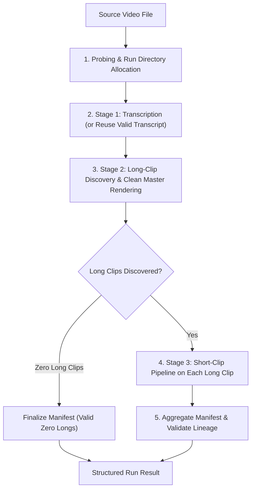

# Stage 4 Orchestration Implementation Plan

**Date**: 2026-10-25  
**Baseline Status**:
- **Stage 1 (Local Media & Transcription Pipeline)**: Implemented, tested, and validated.
- **Stage 2 (Long-Clip Discovery & Packaging)**: Implemented, tested, and validated.
- **Stage 3 (Short-Clip Semantic Anchor Discovery & Rendering)**: Implemented, tested, and accepted via controlled live evaluations.
- **Stage 4 (Pipeline Orchestrator & End-to-End Coordination)**: In progress.

---

## 1. Objective & Boundaries

Stage 4 connects the existing decoupled services (Stages 1, 2, and 3) into an end-to-end, programmatic orchestration workflow.

### Non-Goals for Stage 4 Initial Slice:
- No database (Neon / Postgres / Prisma) or external cloud object storage (Cloudflare R2) requirements; runs remain isolated in local filesystem runs.
- No frontend UI or web worker daemon dependencies.
- No AI model prompt tuning or heuristic changes.
- No external subprocess shelling out; components will be called directly in Python via their established programmatic interfaces.

---

## 2. Existing Component Capabilities & Contracts

| Stage | Service / Function | Input Contract | Output Artifacts |
|---|---|---|---|
| **Stage 1** | `app.services.pipeline.local_pipeline.run_local_pipeline()` | Source video file path, optional output directory | `transcript.json` (TranscriptArtifact), `extracted_audio_16k.wav`, media probe |
| **Stage 2** | `app.cli.discover_candidates.run_candidate_discovery(mode="long")` + `app.services.rendering.long_clip_renderer.render_long_clip_package()` | `transcript.json`, source video path, settings, output run dir | `candidates.json` (long candidates), `long_clips/clip_XX/clip_XX.mp4`, `long_clips/clip_XX/transcript.json`, `long_clips/clip_XX/metadata.json` |
| **Stage 3** | `app.services.candidates.short_pipeline.run_short_clip_pipeline()` | Long master package folder (`long_clips/clip_XX`) | `candidates.json` (short candidates), `short_clips/clip_YY/clip_YY.mp4`, `short_clips/clip_YY/transcript.json`, `short_clips/clip_YY/metadata.json` |
| **Run Persistence** | `app.services.storage.output_manager.OutputManager` | Normalized video name, run date/time | Collision-safe directory: `outputs/YYYY-MM-DD/<video_name>/HH_MM_SS__run_NNN/` |
| **Run Manifest** | `app.domain.manifest.models.RunManifest` | Structured model | `manifest.json` at run root |

---

## 3. Orchestration Workflow Design

The orchestrator service will be located at:
[`backend/app/services/pipeline/orchestrator.py`](file:///C:/Lakshya/Coding/EquinoLabs/ai-video-clipper/backend/app/services/pipeline/orchestrator.py)

### 3.1 Orchestration Steps



1. **Step 1: Input Validation & Isolated Run Initialization**:
   - Validate existence and format of `source_video_path`.
   - Probe media using `probe_media_file` to determine duration, streams, and normalized stem.
   - Allocate collision-safe directory using `OutputManager.create_run_directory(normalized_stem)`.
   - Initialize `RunManifest` in `"running"` status and save initial `manifest.json`.
2. **Step 2: Transcription Execution or Ingestion**:
   - If an existing valid `TranscriptArtifact` or path is provided (e.g. from an existing test package), validate and write/reuse it without expensive re-transcription.
   - Otherwise, invoke `run_local_pipeline()` to extract audio, execute Whisper, and write `transcript.json`.
3. **Step 3: Long-Clip Discovery & Rendering**:
   - If `pipeline_mode` is `"short"` only and a specific long clip is passed, skip Stage 2.
   - Otherwise, run candidate discovery in `mode="long"`.
   - For valid long candidates, invoke `render_long_clip_package()` into `run_dir/long_clips/clip_XX/`.
   - Update `manifest.long_clips`.
   - If zero long clips are found, mark stage as completed (valid zero result).
4. **Step 4: Short-Clip Discovery on Rendered Long Masters**:
   - Iterate over all rendered `long_clips/clip_XX/`.
   - Call `run_short_clip_pipeline()` programmatically for each long clip package.
   - Store short clips inside `run_dir/short_clips/` (or corresponding long package folder).
   - Update `manifest.short_clips` and manifest lineage links (`parent_clip_id`).
5. **Step 5: Finalization & Manifest Persistence**:
   - Mark `manifest.status = "completed"` (or `"failed"` if unrecoverable error).
   - Persist final `manifest.json` atomically using `OutputManager.write_json_atomic()`.
   - Return structured `OrchestratorResult`.

---

## 4. Structured Results & Error Semantics

```python
class OrchestratorResult(BaseModel):
    run_id: str
    run_dir: Path
    status: Literal["completed", "failed", "partial"]
    manifest_path: Path
    manifest: RunManifest
    source_duration_seconds: float
    long_clips_count: int
    short_clips_count: int
    elapsed_seconds: float
    stage_statuses: Dict[str, str]
    errors: List[str]
```

### Error Semantics:
- **Fatal Errors**: Missing source video, corrupt media unreadable by ffprobe, transcription hard failure when no transcript supplied. Result status: `"failed"`.
- **Benign Degeneracies**:
  - LLM discovers 0 long clips $\to$ Status `"completed"`, `long_clips_count=0`, `short_clips_count=0`.
  - Long clips discovered, but a long clip yields 0 short clips $\to$ Status `"completed"`, individual long item has `short_clips_count=0`.
- **Partial Errors**: If 1 of 3 long clips fails rendering due to media error, the remaining long clips continue processing; run status marked `"completed"` with warnings/errors recorded in `manifest.errors`.

---

## 5. Implementation Steps

1. Create [`backend/app/services/pipeline/orchestrator.py`](file:///C:/Lakshya/Coding/EquinoLabs/ai-video-clipper/backend/app/services/pipeline/orchestrator.py) implementing `run_pipeline_orchestrator()`.
2. Add CLI entry point [`backend/app/cli/orchestrate.py`](file:///C:/Lakshya/Coding/EquinoLabs/ai-video-clipper/backend/app/cli/orchestrate.py) for command-line invocation.
3. Write comprehensive unit and integration tests in `backend/tests/unit/test_orchestrator.py`.
4. Run full backend unit suite to guarantee 100% pass rate and regression safety.
